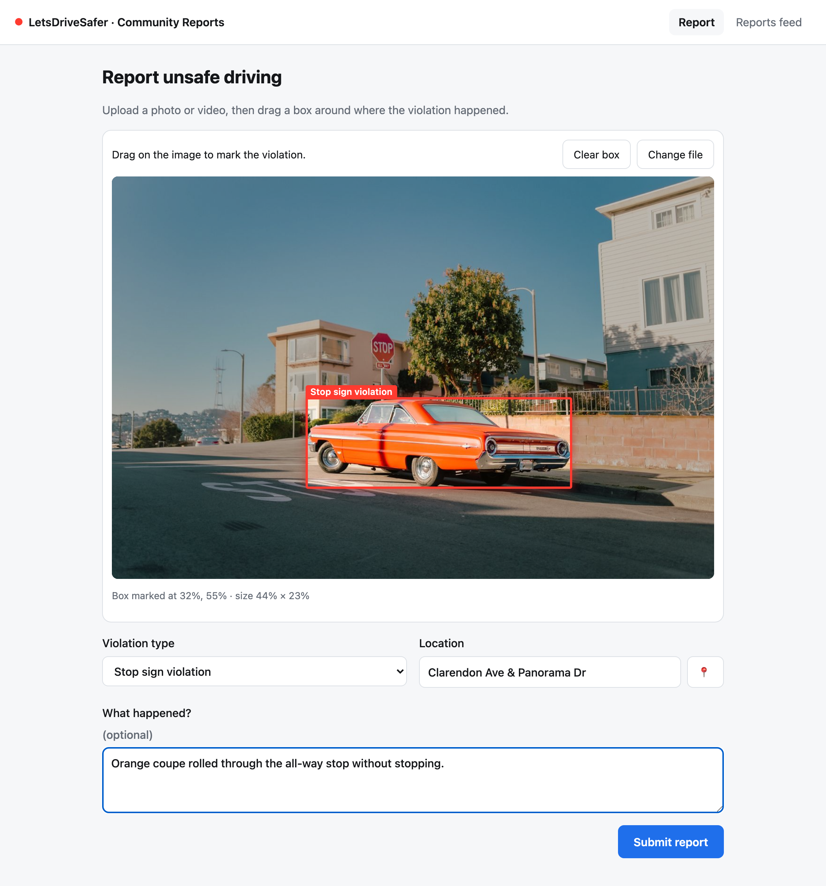
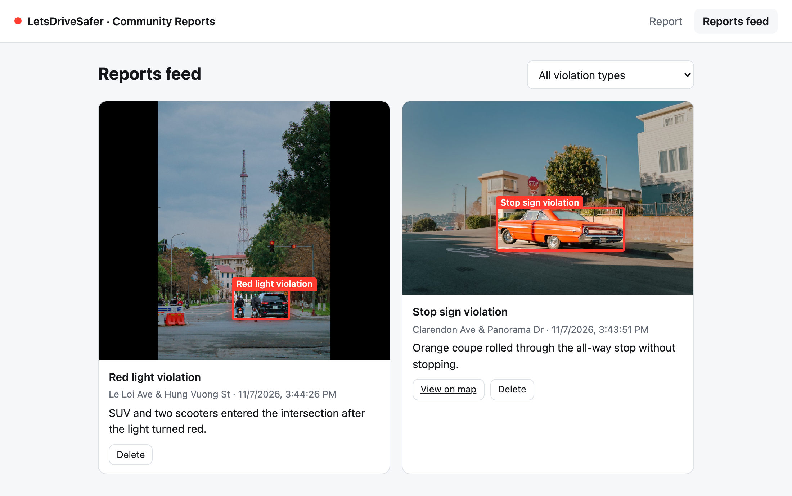

# Community Violation Reports

A small web app that lets residents report unsafe driving. They upload a photo or video and draw a **bounding box** around where the violation happened.

[](https://render.com/deploy?repo=https://github.com/theshizaali/violation-reports)

**Marking a violation:**



**Reports feed:**



## Features
- Upload a photo or video (JPG, PNG, MP4, WEBM, MOV, up to 50 MB).
- Drag a box over the violation. For videos, pause on the moment first; the timestamp is saved with the box.
- Pick a violation type: stop sign, red light, crosswalk, speeding, distracted driving or other. Add an optional location and description, or fill in the location from the browser's location.
- A reports feed shows each report with its box drawn over the media. You can filter by violation type, jump to the marked moment in a video, open a report on a map and delete reports.

## Run it locally
Requires Python 3.9 or newer.

```bash
pip3 install -r requirements.txt
python3 app.py
```

Then open http://127.0.0.1:5050.

The app creates `reports.db` (SQLite) and an `uploads/` folder on first run.

## How it works
- **Backend:** `app.py` is a Flask app with a small JSON API.
  - `POST /api/reports`: submit a report.
  - `GET /api/reports?type=...`: list reports, optionally filtered by type.
  - `DELETE /api/reports/<id>`: delete a report.
- **Frontend:** `static/` holds plain HTML, CSS and JavaScript with no build step. The box is stored as fractions (0–1) of the media's width and height, so it lines up at any screen size.
- **Validation:** The server checks the file type, the violation type and that the box lies inside the frame.

## Deploy a live demo (free)
Click **Deploy to Render** above and sign in to Render. It reads `render.yaml`, installs the requirements and starts the app with gunicorn.

- `SEED_DEMO=1` adds two example reports whenever the database is empty.
- Render's free tier sleeps when idle, so the first visit can take about 30 seconds.
- Uploaded reports are wiped on restart because the free tier has no persistent disk.

## Not production-ready
- There is no login, so anyone can submit or delete reports.
- Each report holds one box.
- Files are stored on local disk.

## Photo credits
The sample photos in `demo/` come from Pexels and are used under the [Pexels license](https://www.pexels.com/license/): [red car at a stop sign](https://www.pexels.com/photo/red-vintage-car-stopped-on-the-crossroads-15706251/) by Josh Hild, and [car and motorcycles at a stoplight](https://www.pexels.com/photo/car-and-motorcycle-passing-the-stoplight-11625269/). The violation captions on them are made up for the demo.

## Test footage
Free traffic clips are available on [Pexels](https://www.pexels.com/search/videos/traffic%20intersection/), [Pixabay](https://pixabay.com/videos/search/traffic/) and [Mixkit](https://mixkit.co/free-stock-video/vehicle/).
